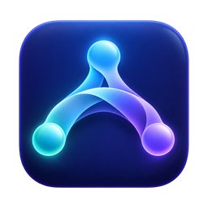

<p align="center">
  
</p>
<h1 align="center">CopilotBridge</h1>
<p align="center"><strong>通过本地 API 使用你的 GitHub Copilot 账号</strong><br>原生 macOS 菜单栏应用，支持 OpenAI 和 Anthropic 兼容客户端。</p>
<p align="center">
  
  
  
  <a href="LICENSE"></a>
</p>
<p align="center"><a href="README.md">English</a> · <strong>简体中文</strong></p>
<p align="center">
  <a href="#从源码构建"><strong>从源码构建</strong></a> ·
  <a href="#连接客户端">客户端配置</a> ·
  <a href="CHANGELOG.md">更新记录</a> ·
  <a href="https://github.com/ProvenceJake/copilotbridge/issues">反馈问题</a>
</p>

---

CopilotBridge 在本机运行 HTTP 服务，供支持 **OpenAI Chat Completions**、**OpenAI Responses** 或 **Anthropic Messages** 的客户端使用。用自己的 GitHub Copilot 账号登录，即可调用该账号可用的模型。

> [!IMPORTANT]
> CopilotBridge 使用实验性的 GitHub Copilot 适配方式，依赖可能变更的 GitHub 内部接口。模型权限和额度以账号及所在组织的策略为准，请使用你有权访问的账号。

## 功能

| 本地 API | 菜单栏操作 | 凭据存储 |
| --- | --- | --- |
| 支持 Chat Completions、Responses、Messages 和模型发现。流式响应、图片输入和工具调用取决于模型及协议。 | 登录、启停服务，并查看当前账号可用的模型及 GitHub 返回的额度。 | 服务仅监听本机回环地址，模型请求使用自动生成的本地密钥。本地密钥和长期 GitHub 令牌保存在 macOS 钥匙串。 |

## 连接客户端

1. 启动 CopilotBridge，从 macOS 菜单栏打开设置。
2. 选择**登录 GitHub**，在浏览器中完成授权。
3. 启动本地服务，复制本地 API 密钥，再从应用的模型列表选择可用模型。
4. 在客户端中填写对应的 Base URL 和密钥。

| 客户端协议 | 默认 Base URL | 主要接口 |
| --- | --- | --- |
| OpenAI 兼容 | `http://127.0.0.1:4141/v1` | Chat Completions、Responses、模型发现 |
| Anthropic 兼容 | `http://127.0.0.1:4141/anthropic` | Messages、估算 token 数、模型发现 |
| Azure OpenAI 兼容 | `http://127.0.0.1:4141` | 按 deployment 调用 Chat Completions 和 Responses |

运行 `curl http://127.0.0.1:4141/healthz` 可检查本地服务是否已启动。Codex、Claude Code、Claude Desktop 第三方推理和 Azure OpenAI 兼容客户端的配置示例见[客户端配置指南](docs/CLIENT_SETUP.md)。

## 从源码构建

使用装有 **Swift 6.1 或更新版本**的 **Apple Silicon Mac**。应用要求 **macOS 14 或更新版本**，构建和打包工具依赖 Xcode。

```bash
git clone https://github.com/ProvenceJake/copilotbridge.git
cd copilotbridge
swift test
swift run CopilotBridge
```

运行 `./scripts/build-app.sh` 可打包用于本机测试的应用。Developer ID 签名、公证和 DMG 打包步骤见[构建指南](docs/BUILD.md)。

## 兼容性

可用模型、图片支持、上下文长度和请求限制取决于 GitHub Copilot 账号。对于 Anthropic Messages，应用会按模型能力选择原生转发，或通过 Chat Completions、Responses 转译。转译支持的字段和路由详见[协议兼容性说明](docs/COMPATIBILITY.md)。

## 许可证

CopilotBridge 使用 [MIT 许可证](LICENSE)。依赖及致谢见[第三方声明](THIRD_PARTY_NOTICES.md)。
